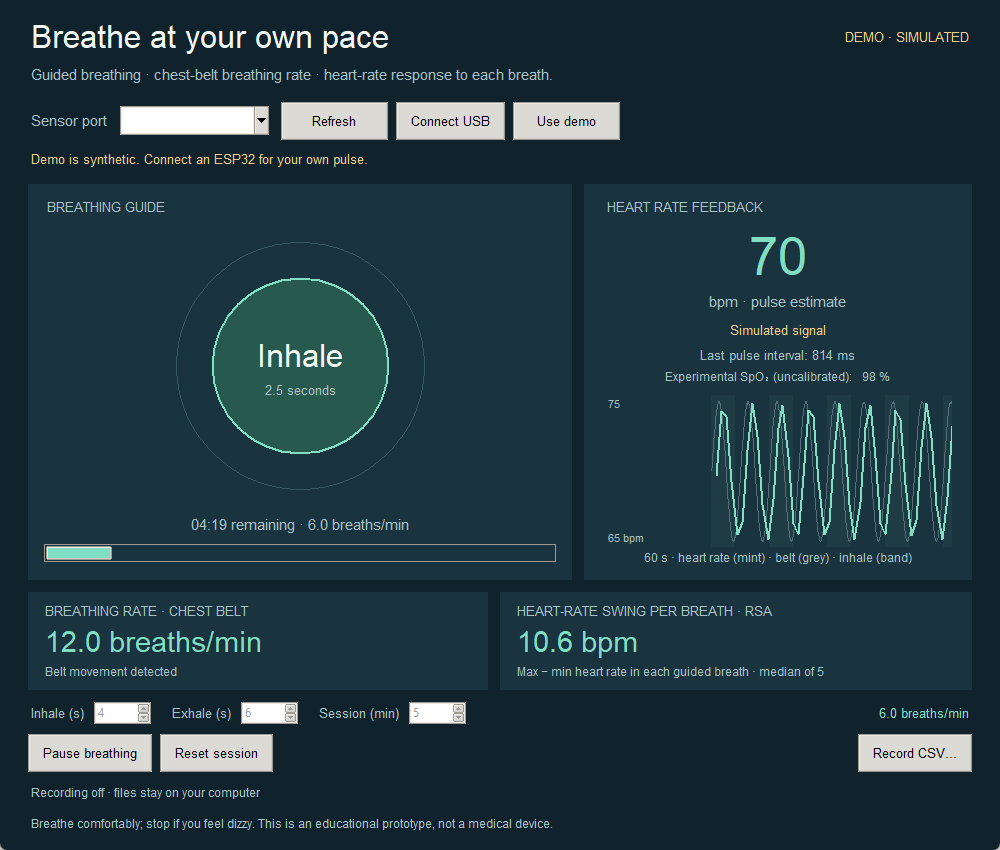

# Breathing Biofeedback Trainer

A low-cost desktop trainer that paces your breathing and shows, breath by breath, how your heart rate responds. An ESP32 reads a fingertip pulse sensor and a motion sensor strapped to the belly and streams both to a Python app over USB. A built-in demo mode lets you try it before buying any parts.



## Try it on Windows (demo, no hardware)

1. Install [Python](https://www.python.org/downloads/windows/) **3.10 or newer**. The standard python.org installer includes Tk, which the window needs.
2. Download or clone this folder and keep its subfolders together.
3. Double-click **Launch_Demo.bat**, or open PowerShell in the project folder and run:

   ```powershell
   py -3 app\trainer.py
   ```

4. Click **Start breathing**. The default guide is 4 s in and 6 s out (6 breaths/min) for 5 minutes. Change the timing to anything that feels comfortable.
5. The **DEMO · SIMULATED** badge stays visible. Demo breathing runs at 12 breaths/min while the guide runs at 6, so you can see that the measured rate never just copies the target.

The breathing rate stays blank for the first 20 s while the belt settles. The heart-rate swing appears after two complete guided breaths.

## The problem

Slow paced breathing at about 6 breaths/min is a common relaxation technique. The thing it measurably changes is **respiratory sinus arrhythmia (RSA)**: your heart rate rises a little on each inhale and falls on each exhale. At slow, steady breathing that swing gets bigger. Most low-cost "breathing trainers" either show only a pacing animation or headline a fingertip SpO₂ number. A healthy person reads 95–99% SpO₂ at rest whatever they do, so that number gives you no feedback about your breathing.

This project shows the feedback that actually responds:

- a pacing guide (the target),
- your **measured** breathing rate from a belly-tilt belt (what you actually did),
- your **beat-to-beat heart rate** drawn over the guide's inhale bands, plus one number: the **heart-rate swing per breath** (max minus min heart rate in each guided breath, median of the last 5).

## Design

```text
MAX30102 (100 Hz red/IR) ─┐  shared I²C
                          ├─ ESP32: beat detection, JSON lines ~25 Hz, 115200 baud ─┐
GY-6500 belly tilt, 25 Hz ┘                                                         │
                                                                                    ▼
 sources.py  reader thread → strict protocol parser → bounded queue (512)
 core.py     DeviceClock · PulseTracker · BreathTracker · hr_swing     (pure, unit-tested)
 trainer.py  Tk window, ticks every 40 ms: guide, readings, 60 s chart, CSV recording
```

Main decisions and why:

| Decision | Why |
| --- | --- |
| Target pace and measured rate are kept fully separate | A trainer that displays its own target as a "measurement" is lying. The breathing rate comes only from the belt signal. |
| Heart rate per beat, not SpO₂, is the headline | RSA is what paced breathing changes. The firmware already sends every beat interval, so this needed no new hardware. SpO₂ is still shown, labelled experimental. |
| Breaths are found cycle by cycle | Each peak and trough is confirmed when the signal reverses by 30% of the user's recent breath size. That follows weak and deep breaths and ignores slow belt drift. The first version (fixed thresholds on a 20 s window) blanked out on realistic breathing; see Evidence. |
| Belly tilt (GY-6500 accelerometer), not a stretch cord | Rubber stretch cord creeps and drifts for minutes, the worst case for breath detection. Tilt from gravity has no creep. The firmware sends it on the same 0–4095 scale as the old belt, so the tuned detector and its tests needed no change. The stretch cord stays as a compile-time option for comparison. |
| Algorithms run on the device clock | USB delivers lines in bursts, so host receipt time jitters. Each packet carries the ESP32's `t_ms`, which `DeviceClock` maps onto host time. |
| Missing data shows `—`, never a default | No plausible-looking number is ever invented. Stale data (over 1 s old), lost finger contact and an unplugged cable all clear the readings. |
| Demo data is always labelled | A permanent badge, and a `demo`/`live` column in every CSV row, so simulated and real data can't be mixed silently. |

The project is human-led engineering with AI-assisted implementation. I reviewed and verified each change by running the tests and the app.

## Evidence

**Software tests:** 22 automated tests, all passing on Windows 11 with Python 3.13 (see [verification](docs/verification.md)). They cover the protocol parser, the guide timing, the device clock, the serial reader (through pyserial's `loop://` port), the breath detector (including a shallow GY-6500 tilt case), the heart-rate swing and the full GUI in demo mode.

**Breath detector stress test (SYNTHETIC signals).** Each cell is a 10-minute simulated session with human-like variation: per-breath period jitter (CV), ±25% breath size, a 40:60 inhale:exhale ratio, slow belt drift and sighs. *Shown* is the share of time a rate is displayed after warm-up. *MAE* is the mean error in breaths/min.

| Case | 6/min shown / MAE | 12/min | 18/min |
| --- | --- | --- | --- |
| Near-sine (CV 5%) | 100% / 0.10 | 100% / 0.26 | 100% / 0.35 |
| Typical (CV 15%) | 100% / 0.27 | 100% / 0.48 | 100% / 0.81 |
| Variable (CV 25%) | 98% / 0.49 | 100% / 1.01 | 100% / 1.39 |
| CV 15% + drift 0.3× breath size | 100% / 0.26 | 100% / 0.48 | 100% / 0.81 |
| CV 15% + drift 1× breath size | 62% / 0.38 | 99% / 0.53 | 100% / 0.82 |
| CV 15% + one sigh/min | 97% / 0.30 | 100% / 0.66 | 100% / 0.85 |

The first version of the detector showed a rate only 26–82% of the time on the same cases, and 0% with drift. The table is also a test (`tests/test_breathing_stress.py`): it fails if a case drops below 95% shown or above 1 breath/min MAE. Known limit: at 6/min, drift as large as the breath itself still hides some breaths (62%, gated at a 50% floor so it can't silently get worse). Regenerate the table with:

```powershell
.\.venv\Scripts\python.exe tests\test_breathing_stress.py
```

**Not yet measured:** nothing in this repo has been tested on a person or a physical sensor. The firmware, including the GY-6500 belt code, compiles with PlatformIO (7% RAM, 23% flash), but its tilt scale (`IMU_COUNTS_PER_DEG = 200`) is an estimate. Belt accuracy against manual counts and pulse against a reference oximeter are still open. The [testing plan](docs/testing_plan.md) lists the procedure.

## Connect real sensors

1. Buy the parts in [the budget](docs/budget.md), one build stage at a time. Estimated total for stages 1–3: **US$15–33** before shipping and tax (planning estimates, not supplier quotes). Stage 1 (pulse sensor only) is US$9–20.
2. Follow [the wiring and belt guide](hardware/wiring.md), including the 3.3 V logic check. For a diagram and a shopping list you can tick off, open [`docs/wiring_bom.html`](docs/wiring_bom.html) in a browser.
3. Upload [the ESP32 firmware](firmware/README.md).
4. Install the one USB dependency in a local virtual environment:

   ```powershell
   py -3 -m venv .venv
   .\.venv\Scripts\python.exe -m pip install -r app\requirements.txt
   .\.venv\Scripts\python.exe app\trainer.py
   ```

   **Launch_Demo.bat** uses `.venv` automatically when it exists.

5. Close the Arduino Serial Monitor, pick the ESP32's COM port and click **Connect USB**. Rest a finger lightly on the MAX30102 and strap the GY-6500 flat on the belly, X arrow toward your head. Keep still.
6. Pulse appears after about 3 beats. Breathing rate takes 20 s of settling plus a few breaths (up to about a minute at slow rates). **Record CSV…** saves raw readings locally.

See [app usage and troubleshooting](app/README.md) for the controls, CSV columns and common problems.

## Measurement limits

This is an educational prototype, **not a medical device**. It is not a pulse oximeter, an apnea monitor or an ECG.

- The belt measures belly movement, not airflow. Body movement can look like breathing.
- Pulse comes from an optical sensor and SparkFun's simple beat detector. Motion, cold fingers and light leaks cause missed or extra beats, which show up directly in the heart-rate swing.
- SpO₂ is an uncalibrated estimate from the Maxim reference algorithm. Don't use it for any health decision.
- The heart-rate swing is a simple max minus min per breath, not a validated HRV measure.

Breathe comfortably and stop if you feel dizzy.

## Project layout

```text
Breathing_Biofeedback_Trainer/
├── Launch_Demo.bat            Double-click to run (uses .venv if present)
├── app/
│   ├── trainer.py             Tk window, chart and CSV recording
│   ├── core.py                Protocol, timing, pulse, breath and RSA calculations
│   ├── sources.py             Demo generator and USB serial reader
│   └── requirements.txt       pyserial only; not needed for demo
├── firmware/                  ESP32 sketch and pinned PlatformIO build
├── hardware/wiring.md         ESP32, MAX30102 and GY-6500 belt assembly
├── docs/                      Protocol, budget, testing plan, verification, review
├── tests/                     Unit, serial, GUI and breathing stress tests
└── sessions/                  Default folder for optional CSV recordings
```

## Developer checks

```powershell
.\.venv\Scripts\python.exe -m unittest discover -s tests
```

The GUI tests need a desktop display. The stress test takes about 25 s. The firmware builds with `.\.venv\Scripts\pio.exe run -d firmware` after `.\.venv\Scripts\python.exe -m pip install platformio`; the first build downloads the ESP32 toolchain (about 5 min).
